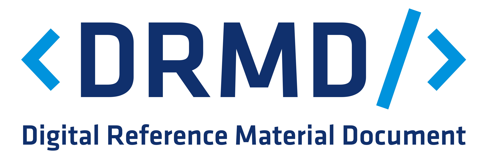

<p align="center">
  <a href="https://bamresearch.github.io/drmd/">
    <picture>
      <source media="(prefers-color-scheme: dark)" srcset="assets/drmd-logo-on-white.png">
      
    </picture>
  </a>
</p>

<h1 align="center">DRMD (Digital Reference Material Document) Landing Page</h1>

<p align="center">
  <a href="https://github.com/BAMresearch/drmd/actions/workflows/pages.yml"></a>
  <a href="LICENSE"></a>
  <a href="LICENSES/EUPL-1.2.txt"></a>
  <a href="https://bamresearch.github.io/drmd/"></a>
</p>

Landing page for the Digital Reference Material Document (DRMD): an XML format for reference material certificates and product information sheets, aligned with ISO 33401:2024.

**Website:** <https://bamresearch.github.io/drmd/>

---

## Resources

| Resource | Link |
|---|---|
| Schema (XML Schema and Schematron business rules) | <https://github.com/BAMresearch/drmd-schema> |
| Guidance document | <https://bamresearch.github.io/drmd-guidance/> |
| Generator (manual entry, editing and AI conversion) | <https://bamresearch.github.io/drmd-generator/> |
| Video guides | <https://bamresearch.github.io/drmd-videos/> |

---

## Contents of this repository

```
index.html                     the page
LICENSE                        CC BY 4.0, the licence of the text (see "Licence" below)
LICENSES/EUPL-1.2.txt          EUPL v1.2, the licence of the code
LOGO_POLICY.md                 terms for using the DRMD logo
CONTRIBUTING.md                how to report an error or ask for a change
assets/
├── drmd-logo.png              DRMD logo, the official artwork
├── drmd-logo-640.png          the same logo, scaled for the page
├── drmd-logo-on-white.png     the same logo on white, for link previews
├── favicon-32.png, favicon-64.png, apple-touch-icon.png
│                              the DRMD logo on a white square, for browser tabs
├── bam-logo.jpg               BAM logo, the official file with its protected space
└── fonts/                     Inter typeface (WOFF2) and its licence
.github/workflows/pages.yml    publishes the page on GitHub Pages
```

The page has no external dependencies. Fonts and images are served from this repository, so no requests are made to other servers when the page is opened. The footer links to BAM's [imprint](https://bam.de/en/disclaimer) and [privacy policy](https://bam.de/en/privacy-policy).

A security policy at the top of `index.html` enforces this: the page runs no scripts and loads only its own fonts, images and styles. A script or a file from another server added later would be blocked, so keep everything in this repository.

The BAM logo follows the BAM corporate design: it is the official file, unchanged, on a white background in the top right corner (on screen and in print), once on the page, without added text, and linked to the BAM home page (<https://bam.de/en/>). Its file contains the protected space around the logo, so the page places nothing over its margins.

---

## Publishing

The page is published with GitHub Actions.

1. In the repository, open **Settings → Pages** and set **Source** to **GitHub Actions**.
2. Push a change to `index.html` or `assets/` on the `main` branch. The workflow publishes it within about a minute.

A publication can also be started by hand: **Actions → Publish on GitHub Pages → Run workflow**.

---

## Changing a link

All links are in `index.html`. When a resource moves, for example to another GitHub organisation, search the file for the old address and replace each occurrence:

- `https://github.com/BAMresearch/drmd-schema`
- `https://bamresearch.github.io/drmd-guidance/`
- `https://bamresearch.github.io/drmd-generator/`
- `https://bamresearch.github.io/drmd-videos/`

The displayed addresses below each resource (`github.com/BAMresearch/drmd-schema` and similar) are in the same file.

---

## Changes and contributions

BAM maintains this page. If you find an error or need a change, please open an issue in this repository or write to [drmd@bam.de](mailto:drmd@bam.de). See [CONTRIBUTING.md](CONTRIBUTING.md).

---

## Licence

© 2026 Bundesanstalt für Materialforschung und -prüfung (BAM)

| What | Licence |
|---|---|
| The text of the page (`index.html`) and this README | [CC BY 4.0](https://creativecommons.org/licenses/by/4.0/), see [`LICENSE`](LICENSE) |
| The code: the HTML structure and the style sheet of `index.html`, and the workflow in `.github/` | EUPL v1.2, see [`LICENSES/EUPL-1.2.txt`](LICENSES/EUPL-1.2.txt) |
| **Inter** typeface (`assets/fonts/`) | SIL Open Font License 1.1, see `assets/fonts/LICENSE.txt` |
| The DRMD logo and the icons made from it (`assets/drmd-logo*.png`, `assets/favicon-32.png`, `assets/favicon-64.png`, `assets/apple-touch-icon.png`) | Not licensed under CC BY 4.0, the EUPL or any other open licence. The logo belongs to BAM and may be used as described in the [Logo Policy](LOGO_POLICY.md) |
| The **BAM** name and logo (`assets/bam-logo.jpg`) | Not licensed. They identify BAM and may not be used without BAM's permission |

CC BY 4.0 lets anyone share and adapt the text, provided they credit BAM, link to the licence and say if they changed it; it gives no right to use the logos or to suggest that BAM endorses them. A changed copy of the page must not carry the DRMD logo or the BAM logo.

The development of the Digital Reference Material Document (DRMD) is partially funded and supported by the [QI-Digital](https://www.qi-digital.de/) project.

---

## Contact

drmd@bam.de

© 2026 [Bundesanstalt für Materialforschung und -prüfung (BAM)](https://bam.de/en/)
